<p align="center">
  
</p>

<p align="center">
  <a href="https://www.anypayx.com"></a>
  <a href="https://github.com/anypay/merchant-app/releases"></a>
  <a href="https://flutter.dev"></a>
  <a href="https://www.anypayx.com/download/ios"></a>
  <a href="https://www.anypayx.com/download/android"></a>
</p>

<p align="center">
  <a href="https://www.anypayx.com">Website</a> ·
  <a href="https://www.anypayx.com/docs">Docs</a> ·
  <a href="https://api.anypayx.com/api">API</a> ·
  <a href="https://www.anypayx.com/walletbot">WalletBot</a> ·
  <a href="https://www.anypayx.com/download/ios">iOS App</a> ·
  <a href="https://www.anypayx.com/download/android">Android App</a> ·
  <a href="https://github.com/anypay">GitHub</a>
</p>

---

## What It Is & Purpose

**Anypay Merchant POS** is a cross-platform Flutter mobile point-of-sale and cash-register app for iOS and Android. Merchants use it at the counter to instantly generate payment invoices, display QR codes, and receive real-time confirmations when customers pay with Bitcoin, Ethereum, stablecoins (USDC, USDT, RLUSD, NUSD), and other supported cryptocurrencies.

This is the core mobile POS client in the Anypay ecosystem. It connects directly to the Anypay invoice platform (`@anypay/server`) via REST API and receives live payment updates through Socket.io and Firebase Cloud Messaging push notifications.

The app eliminates volatility risk by allowing merchants to price in their local currency while accepting crypto payments that settle instantly to their Anypay merchant wallet.

## Why Use It

**Accept crypto at the register without technical complexity.** The Anypay Merchant POS gives brick-and-mortar merchants, pop-up vendors, and service providers the same instant payment experience as traditional card readers — but for Bitcoin, stablecoins, and 10+ blockchains.

- **Who it's for:** Retail merchants, coffee shops, restaurants, pop-up vendors, service providers, and any business accepting in-person payments who want to offer crypto without integration overhead.
- **Where it fits:** This is the **mobile counterpart** to the Anypay web checkout and WooCommerce plugin. While `web3-checkout-vite` powers e-commerce, and `anypay-woocommerce` integrates with online stores, **merchant-app** brings the same instant crypto payment experience to physical points of sale. It pairs with `anypay` (the core invoice platform), `walletbot` (for self-custody settlement), and the Anypay merchant dashboard at `anypayx.com`.

## How It Works

<p align="center">
  
</p>

1. **Cashier Enters Amount** — The merchant opens the app and types in the sale amount in their preferred fiat currency (USD, EUR, etc.). The app authenticates with the merchant's Anypay account stored in secure device storage (`flutter_secure_storage`).

2. **QR Invoice Generated** — The app calls the Anypay invoice API (`POST /invoices`) with the amount and merchant's default currency. The platform generates a universal payment invoice with payment options across Bitcoin, Ethereum, stablecoins, and other supported chains. The app displays the invoice as an animated QR code using `qr_flutter`.

3. **Customer Scans & Pays** — The customer opens their crypto wallet (mobile or hardware), scans the QR code, reviews the payment details (BIP70/BIP270 or chain-specific URI), and authorizes the transaction. The blockchain broadcasts the transaction instantly.

4. **Instant Confirmation** — The Anypay platform monitors the mempool and confirmed blocks via chain-specific workers. The moment a valid transaction is detected (0-conf for fast coins, 1+ confirmations for others), the invoice status updates. The merchant app receives a push notification via Firebase Cloud Messaging and updates the UI with an animated confetti celebration (`confetti` package), showing payment confirmed with transaction details and a shareable receipt link.

The app supports **multi-currency pricing** (the merchant sees prices in USD but the customer pays in BTC or USDC), **offline invoice generation** (invoices can be created without connectivity and sync when online), and **real-time push notifications** so merchants never miss a payment.

## Quickstart / How to Use It

> **Prerequisites:** Flutter SDK 2.7.0 or higher, Xcode 14.2+ (iOS), Android Studio with SDK 21+ (Android), and an [Anypay merchant account](https://www.anypayx.com/auth/signup).

### Clone and Install Dependencies

```bash
git clone https://github.com/anypay/merchant-app.git
cd merchant-app
flutter pub get
```

### iOS Setup

If building for iOS devices, configure the Flutter root path in Xcode:

```bash
# Open the iOS project
open ios/Runner.xcodeproj/

# In Xcode:
# 1. Select Runner (Project, not Targets) → Build Settings
# 2. Click "+" → Add User-Defined Setting
# 3. Key: FLUTTER_ROOT
# 4. Value: (run this command and paste the result)
which flutter | sed 's/.\{11\}$//'

# 5. Select Runner → Info → Configurations
# 6. Set each configuration value to "None"
# 7. Close Xcode, then run:

flutter clean
flutter pub get
rm -rf ~/Library/Developer/Xcode/DerivedData/
cd ios && rm -rf Pods/ Podfile.lock && pod install && cd ..
flutter build ios
open ios/Runner.xcworkspace
```

**Build iOS Release:**

```bash
flutter build ios
open ios/Runner.xcworkspace

# In Xcode:
# - Select Product → Destination → Generic iOS Device
# - Select Product → Archive
```

### Android Setup

**Before building**, update the version in `pubspec.yaml`:

```yaml
version: 2.3.1+19  # Increment the build number (+Y)
```

**Build Android Release:**

```bash
# App bundle for Google Play Store
flutter build appbundle --release --target-platform android-arm,android-arm64,android-x64

# APK for direct distribution
flutter build apk --release
```

### Run in Development

```bash
# iOS Simulator
flutter run -d "iPhone 14 Pro"

# Android Emulator
flutter run -d emulator-5554

# Physical device (must be connected and authorized)
flutter run
```

### Configuration

- **API Endpoint:** The app connects to `api.anypayx.com` by default. The base URL is configured in `lib/client.dart`.
- **Authentication:** Merchant credentials are stored securely using `flutter_secure_storage`. On first launch, merchants log in with their Anypay account (email/password). The auth token is cached and auto-refreshed.
- **Push Notifications:** Firebase Cloud Messaging is configured in `android/app/google-services.json` (Android) and `ios/Runner/GoogleService-Info.plist` (iOS). The app listens for `invoice.paid` events and updates the UI in real time.
- **Currency & Pricing:** Default currency is set in the merchant's account settings on `anypayx.com/settings`. The app fetches supported coins dynamically from the Anypay prices API.

### Testing Push Notifications

Use the included test script:

```bash
./notification_test.sh
```

This sends a test Firebase message to a registered device token. Update the `DATA` variable with your device token and Firebase server key.

## Next Moves for Growth

1. **Dependabot & Security Updates** — The repository has 15+ outdated dependencies flagged by Dependabot. Merge pending PRs for `socket_io_client`, `firebase_messaging`, and Flutter SDK compatibility updates. Run `flutter pub upgrade` and test on latest Flutter stable (3.19+).

2. **CI/CD Pipeline Modernization** — CircleCI config uses `cirrusci/flutter` Docker image with Flutter 3.7.2 (deprecated). Update `.circleci/config.yml` to use Flutter 3.19+ and test against multiple Flutter channels (stable, beta). Add automated Fastlane lane tests before deploy.

3. **Code Signing & Keystore Management** — The build process embeds base64-encoded keystores in CI. Migrate to CircleCI contexts or GitHub Secrets for keystore storage. Document the keystore rotation process and add a local signing guide for contributors.

4. **UI/UX Polish & Dark Mode** — The app supports dark mode via `AppController.enableDarkMode`, but the implementation is incomplete (MUI theme colors from `anypay` web are hardcoded, not aligned with the official Anypay brand palette `#00AB55` / `#161C24`). Audit `lib/app_controller.dart` and `lib/main.dart` to unify the theme with `anypayx.com` marketing palette.

5. **Offline Mode & Local Invoice Storage** — The app generates invoices via API call, which fails without connectivity. Implement a local invoice queue using `sqflite` or `hive` to cache invoices offline, then sync them when network is restored. This is critical for pop-up vendors and markets with unreliable connectivity.

6. **Multi-Language Support** — Add `flutter_localizations` and extract hardcoded strings into `intl` message catalogs. Priority languages: Spanish (Latin America), Portuguese (Brazil), and Mandarin (Asia-Pacific), based on Anypay's merchant base.

7. **Analytics & Crash Reporting** — Integrate Firebase Analytics and Crashlytics to track invoice creation flow, payment success rates, and app crashes. Add custom events for `invoice_created`, `invoice_paid`, `invoice_expired`, and `notification_received`.

## Anypay Ecosystem & License

**Anypay Merchant POS** is part of [Anypay](https://www.anypayx.com) — Bitcoin & Stablecoin payments for business. Merchants and developers use Anypay to accept BTC, ETH, and stablecoins such as USDC, USDT, RLUSD, and NUSD through invoices, APIs, SDKs, webhooks, WooCommerce, and mobile POS.

| Project | Role |
| --- | --- |
| [anypay](https://github.com/anypay/anypay) | Invoice & payments platform / API (`@anypay/server`) |
| [anypay-sdk](https://github.com/anypay/anypay-sdk) | TypeScript SDK for browser & Node.js (`@anypay/client`) |
| [web3-checkout-vite](https://github.com/anypay/web3-checkout-vite) | Current checkout UI (`checkout.anypayx.com`) |
| [walletbot](https://github.com/anypay/walletbot) | Self-custody headless wallet (`@anypay/walletbot`) |
| [anypayx.com](https://github.com/anypay/anypayx.com) | Marketing site, merchant dashboard, and developer docs |
| **[merchant-app](https://github.com/anypay/merchant-app)** | **iOS & Android point-of-sale (this repo)** |
| [anypay-woocommerce](https://github.com/anypay/anypay-woocommerce) | Official WooCommerce plugin |

### Related Mobile & Integration Repos

| Project | Role |
| --- | --- |
| [prices](https://github.com/anypay/prices) | Real-time crypto price aggregation service |
| [plugin-woocommerce](https://github.com/anypay/plugin-woocommerce) | WooCommerce payment gateway plugin (PHP) |
| [anypay-webhook-router](https://github.com/anypay/anypay-webhook-router) | Webhook delivery & retry infrastructure |

### License

This project does not currently have a license file in the repository. For commercial use, partnership inquiries, or licensing questions, contact the Anypay team via [anypayx.com](https://www.anypayx.com) or open a GitHub issue.

The app integrates with open-source dependencies listed in `pubspec.yaml`, each under their respective licenses (MIT, BSD, Apache 2.0). See `pubspec.lock` for the full dependency tree.

---

<p align="center">
  <a href="https://www.anypayx.com"></a><br/>
  <sub>Bitcoin & Stablecoin Payments For Business · <a href="https://www.anypayx.com">anypayx.com</a> · <a href="https://x.com/xanypay">@xanypay</a></sub>
</p>
